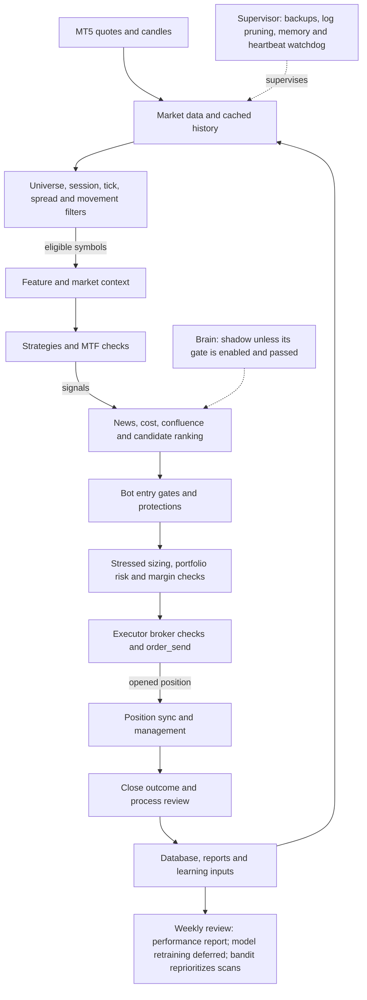

# Bot pipeline

This describes the runtime flow implemented by `src/bot.py`,
`src/scanner.py`, `src/executor.py`, and `scripts/run_forever.py`. The diagram
follows a normal cycle; weekend and explicitly eligible DEMO exploration use
their configured risk limits within the same protections.

## Qısa izah

1. **Məlumat:** Bot öz MT5 sessiyasından kotirovka və şamları oxuyur. Botun
   hərəkət dövründə tarixçə kiçik hissələrlə yenilənir; xəbər təqvimi üçün aktiv
   mənbə və ya qoruyucu ehtiyat filtri istifadə olunur.
2. **Skan və strategiyalar:** Skaner alətləri sessiya, kotirovka, spred və
   hərəkətə görə ələyir, sonra texniki xüsusiyyətləri və bazar kontekstini
   hazırlayır. Strategiyalar bağlı şamlarda siqnal və çoxzamanlılıq uyğunluğu
   axtarır. Namizədlər xərc, confluence və gözlənilən dəyərə görə sıralanır.
3. **Beyin:** Beyin nəticələri və tövsiyələri müşahidə üçün hesablana bilər.
   Qəbul qapısı keçməyib aktivləşdirilməyincə giriş qərarına təsir etmir.
4. **Risk və sifariş:** Bot sağlamlıq, hesab rejimi, giriş icazəsi, qoruyucu
   limitlər, xərc və portfel riskini yoxlayır. Həcmi gərginləşdirilmiş stop
   xərci ilə hesablayır. İcraçı brokerin minimumları və stop qaydalarını
   yenidən yoxlayır, sonra MT5-ə sifariş göndərir.
5. **İcmal:** Açıq mövqelər sinxronlaşdırılır və stop, hədəf, izləyən stop,
   vaxt və sessiya qaydaları ilə idarə olunur. Bağlanmış əməliyyatın nəticəsi
   və qərar prosesinin keyfiyyəti ayrıca qeydə alınır.
6. **Həftəlik və planlı işlər:** Bot gündəlik yekun, həftəlik performans
   icmalı və balans qeydləri yaradır. Supervisor ehtiyat nüsxə və log təmizliyini
   planlayır, yaddaş və heartbeat-i izləyir. Həftəlik model yenidən təlimi tam
   təsdiq axını olmadığı üçün təxirə salınıb; bandit yalnız skan prioritetini
   dəyişir. Supervisor-un saatlıq tarixçə işi texniki icra markeridir; real
   inkremental yükləmə botun öz MT5 sessiyasında baş verir.

## Live funnel

The dashboard records one row per completed bot scan cycle. Its one-hour
counts are: visited symbols, symbols passing initial tradability/spread
filters, generated strategy signals, candidates that clear bot-side gates and
reach the executor, and successful order opens. Rejection summaries use the
scanner's filter reasons, strategy diagnostics, bot-side gate reasons, and
broker/executor failures respectively. “Passed risk” means an order attempt
was reached after bot-side checks; broker validation can still reject it.
